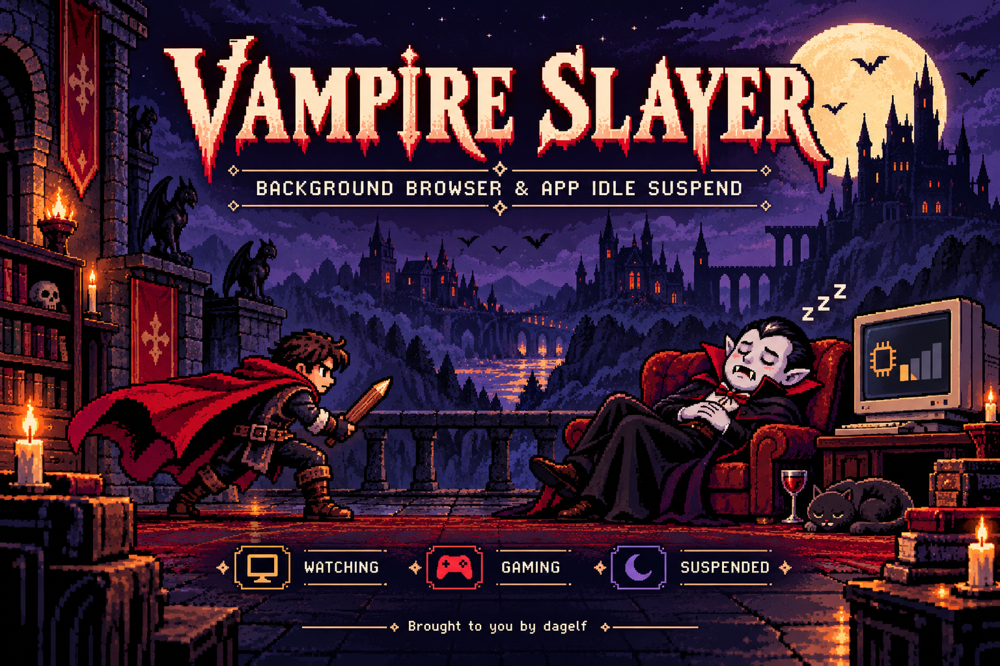
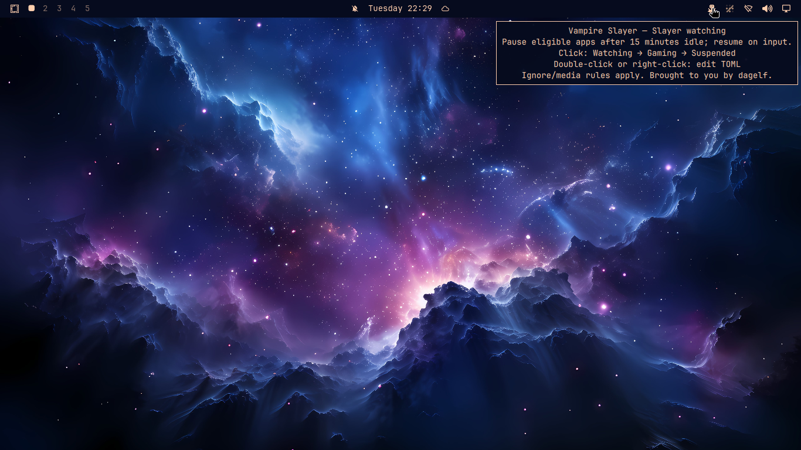

<p align="center">
  
</p>

# Vampire Slayer: background browser and app idle suspend

**Brought to you by [dagelf](https://github.com/dagelf).**

[Install](#install-on-omarchy) · [Modes](#one-vampire-three-modes) · [Hotkeys](#hyprland-hotkeys) · [Configuration](#your-policy-preserved-across-plugin-updates)

**Chrome or Firefox eating CPU while you're out for lunch, even when they have nothing to do? Vampire Slayer to the rescue.**

Put background browsers and apps on pause when you walk away. Vampire Slayer
suspends idle Chrome, Chromium, Firefox, Opera, Brave, and Electron app families,
then resumes them when you return to the keyboard or mouse. Your tabs and windows
stay open; unnecessary background CPU work stops while the apps are suspended.

**Less background CPU work. More battery for what you actually want to do.**
Pausing idle apps can reduce power consumption and help extend laptop battery life,
including while you watch a film or listen to music. **Detected audio/video keeps
playing by default, and allowed apps on your ignore list keep running.** Gaming
mode can pause the other eligible apps immediately while your media continues.
Savings depend on the apps and hardware; Vampire Slayer does not claim a fixed
battery-life increase. Media exemptions require actual MPRIS `Playing` status,
not just an open media session.

An **Omarchy plugin for Hyprland**, with automatic Wayland and X11/VNC support.
Keep detected music and video playing, choose an ignore list for apps that must
stay awake, or suspend even with media. Optional background-worker exceptions
let you preserve builds and other jobs; they are off by default. No polling loop,
no browser extension, and no second Quickshell instance.

## One vampire, three modes

Click the vampire in your bar to cycle **Watching → Gaming → Suspended → Watching**.
The monochrome pixel glyph changes pose with the mode and follows your bar's theme.
Hover for the current state, what it does, and the next action.

| Mode | What happens |
| --- | --- |
| **Slayer watching** | Automatically suspend eligible app families after 15 minutes without input on their desktop; resume when you return. |
| **Gaming mode** | **Suspend all eligible background app families immediately**, without waiting for idle. Keep them paused while you use the keyboard and mouse to play. |
| **Slayer suspended** | Resume the apps and turn automatic suspension off. The vampire stays in the bar, ready to wake up. |

“Background apps” means your configured browser/Electron suspend list and detected
Electron apps, not every Linux process. Gaming mode applies to matching apps across
your displays, including any matching app you were using. Games and system services
are not added to the suspend list. Ignore rules always win; playing-media exemptions
and optional worker exceptions still apply. Set `suspend_media = ["*"]` in your
TOML if you also want media apps paused. Gaming evaluates apps when entered and
when media changes; it does not continuously hunt newly launched processes.

Leaving Gaming resumes apps before entering the next mode. Returning to Watching
starts a fresh idle interval. The icon follows systemd state, including service
failure or an external stop; it does not optimistically report a successful click.
Click again after editing your policy to re-enter an active mode and apply it.

**Double-click or right-click the vampire to edit your TOML.** A double-click opens
the editor without switching modes. Single-click waits for the desktop's
double-click interval; a hotkey mode change is immediate. Omarchy's selected editor
opens, defaulting to Neovim in a terminal. The first edit creates a personal copy;
existing settings are never overwritten.

Color sprites are optional, using Omarchy's standard widget setting:

```sh
omarchy bar set dagelf.vampireslayer colorIcons true --json
# Return to theme-colored monochrome glyphs:
omarchy bar set dagelf.vampireslayer colorIcons false --json
```

<details>
<summary>See Vampire Slayer running in Omarchy</summary>



</details>

## Hyprland hotkeys

Following [Omarchy's plugin IPC convention](https://github.com/omacom/omarchy/blob/quattro/docs/omarchy-shell.md#ipc),
mouse actions and shortcuts call the same service. No bindings are installed or
overwritten automatically. Add these examples to `~/.config/hypr/bindings.lua`:

```lua
o.bind("SUPER + ALT + V", "Vampire Slayer: edit TOML", "omarchy-shell dagelf.vampireslayer edit")
o.bind("SUPER + ALT + F12", "Vampire Slayer: cycle mode", "omarchy-shell dagelf.vampireslayer cycle")
```

These combinations are unused in the checked Omarchy defaults; check your own
custom bindings with `omarchy menu keybindings --print`. **Super+V is already
Universal paste** and Super+Ctrl+V opens the clipboard manager.

For Hyprland installations still using `.conf` bindings:

```ini
bind = SUPER ALT, V, exec, omarchy-shell dagelf.vampireslayer edit
bind = SUPER ALT, F12, exec, omarchy-shell dagelf.vampireslayer cycle
```

Direct actions can be bound to any keys you prefer:

```sh
omarchy-shell dagelf.vampireslayer gaming
omarchy-shell dagelf.vampireslayer watching
omarchy-shell dagelf.vampireslayer suspended
omarchy-shell dagelf.vampireslayer status
omarchy-shell dagelf.vampireslayer edit
```

Mode requests return `requested …`, `busy`, or an error; `status` reports the
observed state. Commands require the plugin to be enabled in the running shell.
The widget shares one service across monitors. Full integration uses Omarchy's
built-in bar; third-party replacement bars may restrict service access.

Vampire Slayer is the plugin name; `background-suspend` remains the standalone CLI.
The implementation is process suspension, not memory reclamation or a promise
that every background task is unnecessary. Use exceptions for work you want to
continue, including uploads or workers that aren't exposed as separate processes.

## Install on Omarchy

Requires Omarchy Quattro's plugin system, systemd user services, Python 3.11+,
`python-dbus`, and `python-gobject` on Arch. Hyprland already provides the Wayland
client library. X11/VNC watching additionally uses `xorg-xinput` and `coreutils`.
Install missing dependencies using your package manager; the plugin never runs sudo.

```sh
omarchy plugin add https://github.com/dagelf/vampireslayer
omarchy plugin enable dagelf.vampireslayer
```

Omarchy loads the bar widget and `Service.qml` inside its existing shell. It starts the backend with
`systemd-run --user` as **vampireslayer.service**, including an `ExecStopPost` resume
command. Systemd owns process shutdown and cleanup. The transient unit is collected
when stopped; no permanent service file or system-wide installation is needed.
The plugin passes only desktop-session environment variables to its unit. A small
D-Bus observer reports unit changes to the icon without polling or a status timer.

The existing standalone `background-suspend.service` remains available for people
who prefer a permanently installed systemd user service. Do not run both modes.
If an old `firefox-idle.service` or standalone watcher is active, the plugin refuses
to start until you stop it explicitly.

```sh
systemctl --user status vampireslayer.service
journalctl --user -u vampireslayer.service
omarchy plugin disable dagelf.vampireslayer
systemctl --user stop vampireslayer.service  # Wait for cleanup before deleting files
omarchy plugin remove dagelf.vampireslayer
```

Disabling stops the unit and resumes suspended apps. Before removing the plugin,
wait for the stop command above to finish: the fallback cleanup uses the checkout.
A shell crash does not kill the systemd-managed watcher; it keeps reacting to
activity until stopped or the user session ends. `systemctl --user stop
vampireslayer.service` is also available directly. A crashed backend is resumed
through `ExecStopPost`, without an automatic failure/restart loop.

The service entry is kept across ordinary QML hot reloads. After updating QML code,
run `omarchy-restart-shell` so cached components are replaced. For policy changes,
reselect Watching or Gaming, or restart `vampireslayer.service`.

## Your policy, preserved across plugin updates

Double-click the vampire or use the editor hotkey above. Defaults ship in
`background-suspend.toml`. You can also create a user copy manually; an existing file is never overwritten by this command:

```sh
mkdir -p ~/.config/vampireslayer
cp -n ~/.config/omarchy/plugins/dagelf.vampireslayer/background-suspend.toml ~/.config/vampireslayer/
```

Edit `~/.config/vampireslayer/background-suspend.toml`, then reselect an active mode or restart the service.
`XDG_CONFIG_HOME` is respected. Both plugin and CLI prefer this user copy when it
exists; an explicit `--config` selects a different file. Uninstalling the plugin
preserves your policy.

## Related Linux desktop tools

- [Graphic equalizer / PipeWire web EQ](https://github.com/dagelf/eq): a ten-band
  stereo graphic equalizer, preamp, presets, per-output settings, application
  mixer, and MPRIS media controls. Native C processing/control with a browser UI.
- [Audio pause/cycle hotkeys](https://github.com/dagelf/media-hotkeys): pause all
  audio players, cycle one MPRIS source at a time, and return to silence. Includes
  Hyprland/Omarchy and IceWM keyboard shortcut examples.
- [Linux CLI utilities](https://github.com/dagelf/utils): the original home of the
  media-cycle hotkey and other small desktop tools.

Search terms: Vampire Slayer, vampireslayer, background browser and app idle
suspend, Chrome CPU, Chromium CPU, Firefox CPU, Electron CPU, out for lunch,
Omarchy plugin, Hyprland, Wayland, X11, VNC, power management, Gaming mode, Hyprland hotkeys, pixel art, graphic equalizer,
PipeWire, audio pause, audio cycle, media hotkeys.

## Suspension behavior

Suspend browser and Electron process families after 15 minutes without real input
on their X11/VNC display or Wayland session. Activity resumes that session's apps. This retains the
original per-display idle model: it does not suspend an unfocused app while you
are using another app on the same display. XTEST-generated input is ignored on
X11; on Wayland, the compositor decides which activity resets its idle counter.

## Desktop detection

No backend setting is needed. If `WAYLAND_DISPLAY` is set, connect to that socket
and detect the available API:

- **Hyprland, Sway, KDE, and other supporting compositors:** use
  [`ext-idle-notify`](https://gitlab.freedesktop.org/wayland/wayland-protocols/-/blob/main/staging/ext-idle-notify/ext-idle-notify-v1.xml)
  through the system `libwayland-client.so.0`. No additional daemon, package,
  build step, raw input access, or polling is needed.
- **GNOME/Mutter:** when the protocol is absent, use its
  [IdleMonitor D-Bus API](https://github.com/GNOME/mutter/blob/main/data/dbus-interfaces/org.gnome.Mutter.IdleMonitor.xml).
  Verify that the service belongs to the connected compositor before using it.
- **X11/VNC:** retain XInput watching on each independent X server. The current
  Wayland session's XWayland display is excluded from XInput watching, so native
  and XWayland apps share one authoritative idle state.

Native Wayland apps no longer need `DISPLAY`. Other VNC displays remain independent.
The exported `WAYLAND_DISPLAY`, `XDG_RUNTIME_DIR`, and `DISPLAY` identify the current
Wayland session and its XWayland server. Launch independent X11/VNC sessions with
`WAYLAND_DISPLAY` unset so they do not inherit the host session's identity.

Version 2 of the Wayland protocol supplies input-only idle notifications, allowing
our per-app media policy to work independently of compositor idle inhibitors.
Version 1 is supported but honors compositor inhibitors; those may prevent idle
notifications even with `--suspend-media`. There is no universal raw-input API
across all Wayland compositors. Unsupported APIs, disconnects, and seat removal
leave the affected apps resumed; restart the watcher after restoring the session.

## Defaults and exceptions

Use [`background-suspend.toml`](background-suspend.toml) as the policy reference. Restart the watcher after
editing your user policy. Patterns are case-insensitive shell globs, not regular expressions.

| Setting | Default and meaning |
| --- | --- |
| `suspend` | Firefox, Chromium, Chrome, Opera, Brave, other browser variants, common Electron apps and editors, Electron and NW.js runtimes. Matches executable basenames. |
| `detect_electron` | `true`: also recognize renamed executables with adjacent `resources/app.asar` or `resources/electron.asar`. |
| `ignore` | `[]`: never suspend matching app families. A matching executable anywhere in the family exempts the whole family. Takes precedence over other options. |
| `suspend_media` | `[]`: keep every app with detected playing media awake. List app-root executable patterns to suspend them even with media; `["*"]` disables media exemptions entirely. |
| `worker_exceptions` | `false`: opt in to preserving apps with matching background workers. |
| `background_workers` | Configurable process/argument-token patterns for Node, builds, language servers, explicit worker scripts, transfers, and headless jobs. Used only when worker exceptions are enabled. |

App roots need a `DISPLAY` or `WAYLAND_DISPLAY`; all their owned descendant processes follow their
policy, including helpers without either variable. A standalone Node/Bun/Deno server
is not selected merely because it runs JavaScript. Add its executable to `suspend`
explicitly if wanted. The controller's own ancestor family is always protected.

Media detection listens to **all** registered MPRIS players and maps their PIDs
back to app families, including players hosted in helper processes. Only
[`PlaybackStatus = Playing`](https://specifications.freedesktop.org/mpris/latest/Player_Interface.html)
grants an exemption. Paused/stopped players do not. Media not exposed through
MPRIS, such as some calls and WebAudio applications, cannot be detected. Unknown
status temporarily releases suspensions; a failed monitor resumes apps and exits.
When media exemptions are disabled globally, no media monitor is required.

Worker exceptions protect an **entire app family**, not just its worker. A worker's
existence is the signal, not CPU use: a long-lived idle Node worker will also keep
the app awake. Worker exits trigger an immediate recheck using pidfds, with no
polling timer. Browser service workers and worker threads inside renderers cannot
be reliably classified from OS process names; use an app ignore rule for those.

## Commands

Requires Linux pidfds and Python 3.11+. X11 watching uses `xinput` and `stdbuf`;
Wayland watching uses the compositor's existing `libwayland-client`. Media
monitoring and the Mutter fallback use `python3-dbus` and `python3-gi`.
Only the needed backend is started. No browser extension or remote-debugging port is required.

```sh
./background-suspend list                         # Read-only app/decision preview
./background-suspend run                          # Default policy, 15-minute idle time
./background-suspend run --ignore code             # Extra ignore rule for this run
./background-suspend run --suspend-media            # Suspend even with playing media
./background-suspend run --suspend-media 'chrome*'  # Override media for selected roots
./background-suspend run --worker-exceptions       # Opt in to worker exceptions
./background-suspend run --config ./custom.toml    # Alternative policy
./background-suspend resume                       # Resume configured app families
```

`list` shows what would happen when a display becomes idle, not whether its idle
deadline has elapsed. The ignore list always wins, including in `gaming` mode.

The service controls are `start`, `stop`, `status`, and `gaming`. `gaming` stops
automatic watching and immediately suspends eligible apps, respecting media and
worker exceptions. Use `gaming --suspend-media` to override media, and `start` to
return to automatic mode. Gaming exemptions are a one-time snapshot; worker/media
changes are followed only in `run` mode. Put persistent policy in the TOML file;
service controls do not pass command-line policy overrides to systemd.

## Standalone systemd installation

For a checkout at `~/vampireslayer`, the supplied permanent user unit is an
alternative to the Omarchy plugin. Stop any previous watcher before switching:

```sh
systemctl --user disable --now firefox-idle.service
mkdir -p ~/.config/systemd/user
install -m 644 background-suspend.service ~/.config/systemd/user/
systemctl --user daemon-reload
./background-suspend start
```

The legacy `firefox-idle` launcher is retained for existing users of the original
`~/utils/scripts/firefox-idle`; new users should use the plugin or `background-suspend`.

The supplied unit assumes the checkout is `~/vampireslayer`; adjust its paths if
you move it. Do not run both watchers on the same displays.

On Wayland, the user service needs the same session variables as applications.
Desktop session managers often import them already. If yours does not, run this
from the compositor's session-start hook before starting/restarting the service:

```sh
systemctl --user import-environment WAYLAND_DISPLAY DISPLAY XDG_RUNTIME_DIR
```

An unset `DISPLAY` is fine on a native-only session. Run directly from a Wayland
terminal with `./background-suspend run` to use its environment without systemd.

## Roadmap

- **Optional foreground-only execution:** suspend all eligible apps unless they are
  foreground; resume on focus and suspend again when they move to the background.
  Keep media and allowed-app exceptions configurable. This requires compositor/window
  focus tracking and reliable window-to-process-family mapping, including multi-window
  apps and multiple monitors. It is planned, not implemented; today's modes use
  session idle or an explicit Gaming action.

## Verification

```sh
PYTHONDONTWRITEBYTECODE=1 /usr/bin/python3 -m unittest -v test_background_suspend test_wayland_idle test_plugin test_gaming
```

Tests use disposable app-named Python processes, synthetic input connections, and
a private D-Bus session. They cover family selection, media state changes, stale
replies, ignore precedence, media overrides, worker exits, PID reuse, and cleanup
after monitoring failure. Wayland tests exercise the real client library with a
private protocol peer, compositor-authoritative state, and a private Mutter API
service. They do not suspend desktop apps. A live Wayland desktop is not required.


For an optional live systemd check, run
`VAMPIRESLAYER_TEST_SYSTEMD=1 python3 -m unittest test_plugin`. It creates a
disposable waiting Python service and verifies cleanup after stop and forced exit.
It never runs the browser suspension backend.

The Omarchy manifest follows the [official development guide](https://plugins.omarchy.org/develop.html)
and [publishing guide](https://plugins.omarchy.org/publish.html). Validate with
`omarchy plugin validate .` and `qmllint Service.qml Widget.qml PixelVampire.qml` on an Omarchy installation.
The repository is licensed under [MIT](LICENSE).

On an Omarchy installation, `python3 tests/qml_smoke.py` exercises mode cycling
and editor gestures in a private offscreen shell with a fake backend. It does not
touch your live services. Live VNC validation is recorded in [VALIDATION.md](VALIDATION.md).

The banner is original promotional artwork, not a desktop screenshot. See [artwork notes](ARTWORK.md) for its generation prompt and marketplace references.
